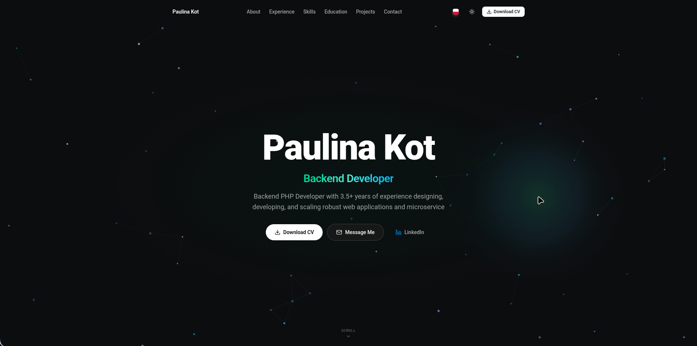

# Resume & Portfolio Landing Page

A modern, high-performance developer portfolio and interactive resume platform built with **Laravel**, **Vue 3**, **Inertia.js**, **Tailwind CSS v4**, and **Filament 5**.



---

## Architecture & Design Principles

The application is built around a lean, cost-efficient, single-server architecture optimized for blazing-fast page loads, minimal memory footprint, and low-maintenance operation.

```
[ Visitor / Recruiter ] ──HTTPS──> [ Host Proxy (Nginx / Caddy) ] ──Port 8080──> [ FrankenPHP App Container ]
                                                                                       └── SQLite Database (Storage Volume)
```

- **FrankenPHP (ServersideUp Alpine):** Instead of running multiple containers for Nginx and PHP-FPM, FrankenPHP embeds the PHP interpreter directly into the Caddy web server. This runs as a single lightweight container, halves memory overhead, enables OPcache pre-compilation, and delivers microsecond response times.
- **Self-Contained SQLite Architecture:** Unlike traditional web apps requiring external MySQL and Redis daemons, this platform runs entirely on SQLite with database-backed sessions and cache. Everything lives inside a single Docker volume (`storage:` mounted at `/var/www/html/storage/database/database.sqlite`), drastically cutting hosting costs and simplifying backups.
- **Lean Multi-Stage Docker Builds:** The Docker build pipeline isolates dependency installation, compiles Vue assets with Vite, and caches Filament components into a minimal Alpine production image. Build tools, Node, and `node_modules` are completely stripped from production.
- **Host Reverse Proxy (Port 8080):** The container publishes port `8080` (and `8443`) rather than binding directly to ports `80`/`443`. A host-level reverse proxy (Nginx or Caddy) terminates SSL and routes requests, allowing multiple web applications to share a single VPS effortlessly.
- **Monolith with Inertia.js:** Inertia seamlessly bridges Laravel and Vue 3 without the overhead of building, documenting, and versioning a separate REST/GraphQL API. It delivers a fast, client-rendered Single Page Application experience with server-side routing and authorization.
- **Automated CI/CD Pipeline:** GitHub Actions runs code style checks (Laravel Pint), static analysis (PHPStan / Larastan), TypeScript validation (`vue-tsc`), and automated tests (Pest) on every push. When tests pass on `master`, it executes an automated deployment over SSH.

---

## Technology Stack

| Layer                    | Technology                                 | Purpose                                                       |
| :----------------------- | :----------------------------------------- | :------------------------------------------------------------ |
| **Backend Framework**    | Laravel 12 / PHP 8.5                       | Application architecture, ORM, and request routing            |
| **Frontend Framework**   | Vue 3 (Composition API)                    | Reactive single-page user interface                           |
| **Client-Server Bridge** | Inertia.js v3                              | Seamless SPA state transfer without separate API endpoints    |
| **Styling & Icons**      | Tailwind CSS v4 & Lucide Icons             | Responsive modern styling, typography, and iconography        |
| **Admin Panel**          | Filament 5                                 | CMS dashboard for managing content, resume entries, and media |
| **Internationalization** | Laravel Localization & Spatie Translatable | Dual-language support (English & Polish) for all content      |
| **Database & Cache**     | SQLite 3                                   | Zero-overhead relational database, session storage, and cache |
| **Runtime & Infra**      | Docker, FrankenPHP, GitHub Actions         | Multi-stage container builds, web server, and automated CI/CD |

---

## Features

### Public Resume & Portfolio (Vue 3 + Inertia.js)

- **Hero & Executive Summary:** Clean introduction with animated highlights, contact shortcuts, and instant theme toggling.
- **Interactive Project Showcase:** Responsive grid with tech stack badges, repository links, live demos, and case study previews.
- **Project Detail Modal with Full-Screen Lightbox:** Rich modal displaying engineering highlights and in-depth articles. Clicking any project screenshot opens an uncropped, high-resolution lightbox viewer with keyboard navigation (`Esc`, `ArrowLeft`, `ArrowRight`) and a thumbnail strip.
- **Curriculum Vitae Preview & Print Mode:** In-browser CV modal with dedicated print stylesheets for export and one-click PDF downloads.
- **Work Experience & Education Timeline:** Structured chronological history with roles, companies, achievements, and degrees.
- **Categorized Skills Matrix:** Visual tech stack tags organized by specialization (Backend, Frontend, DevOps, Tools).
- **One-Click Contact & Copy:** Quick-copy buttons for email address and phone number with animated toast notifications.
- **Dual-Language i18n (EN / PL):** Seamless instant language switching with localized copy and locale-aware CV downloads.
- **Dark & Light Mode:** System-aware theme toggle with persistent preference saved to local storage.

### Back-Office Administration (Filament 5)

- **General Information Management:** Update personal branding, contact info, job titles, bio summaries, and upload language-specific CV PDFs.
- **Comprehensive Project Management:** Create and edit portfolio entries with translatable text, categories, tech tags, cover images, multi-image galleries, and rich-text markdown case studies.
- **Experience & Education Management:** Full CRUD management for employment history, responsibilities, and academic credentials.
- **Skills & Quick Stats Control:** Dynamically update skill pills and headline stats displayed on the landing page.
- **Section Settings Toggle:** Enable or disable any section (About, Experience, Skills, Education, Projects, Contact) from the admin dashboard without code changes.
- **Security & Two-Factor Authentication:** Built-in 2FA support (Google Authenticator / QR code) for administrative accounts.

---

## Getting Started

> **Note:** The included `compose.yaml` and `Dockerfile` are configured for **production**. For local development, choose either Lerd or native host tools.

### Option 1: Lerd (Recommended)

Spins up the development environment automatically:

```bash
lerd start
composer setup
```

The application will be live at: `https://resume-landing-page.test`

### Option 2: Host Environment (PHP 8.5 & Node.js 22+)

```bash
# 1. Clone repository
git clone https://github.com/paukot/resume-landing-page.git
cd resume-landing-page

# 2. Install dependencies
composer install
npm install

# 3. Configure environment
cp .env.example .env
php artisan key:generate

# 4. Initialize database and link storage
php artisan migrate --seed
php artisan storage:link

# 5. Build assets and launch dev server
composer dev
```

---

## Production Deployment & Docker

The production environment runs via Docker Compose with automatic database preparation, migrations, and storage linking on startup.

### 1. Initial Setup on Server

```bash
git clone https://github.com/paukot/resume-landing-page.git /var/www/resume-landing-page
cd /var/www/resume-landing-page

# Configure production environment
cp .env.docker.example .env
# Fill in APP_KEY, APP_DOMAIN, etc. in .env
```

### 2. Deploy

Run the automated deployment script:

```bash
chmod +x deploy.sh
./deploy.sh
```

The script fetches latest changes, rebuilds containers with `--pull`, applies pending migrations, and removes stale images.

---

## Database Backup & Restore

Because SQLite stores all relational data in a single file inside the persistent `storage` volume, backups are lightweight, fast, and completely safe to run while the application is live:

### Create an Online Backup

Run the backup script (safe during live traffic and WAL mode transactions):

```bash
./backup.sh
```

- Creates a timestamped, gzip-compressed snapshot in `backups/db-YYYYMMDD-HHMMSS.sql.gz`.
- Verifies archive integrity with `gzip -t`.
- Automatically rotates archives, keeping the newest 14 backups (`KEEP=14`).

### Restore from Backup

```bash
gunzip -c backups/db-<TIMESTAMP>.sql.gz | docker compose exec -T app sh -c 'sqlite3 "$DB_DATABASE"'
```

---

## Testing & Code Quality

Run tests and static analysis with standard commands:

```bash
composer test         # Runs Pint style check, PHPStan static analysis, and Pest test suite
composer lint         # Automatically format PHP code with Laravel Pint
composer types:check  # Run PHP static analysis with PHPStan (Larastan)
npm run types:check   # Run Vue 3 / TypeScript verification via vue-tsc
npm run build         # Compile production frontend assets with Vite
```

---

## Project Structure

```
├── app/
│   ├── Filament/Resources/ # Admin panels (Projects, Experience, Education, Settings, etc.)
│   ├── Http/Controllers/   # WelcomeController and landing page endpoints
│   ├── Http/Resources/     # API/Inertia resource serializers (ResumeResource, ProjectResource)
│   ├── Models/             # Eloquent models (Project, Experience, SectionSetting, etc.)
│   └── Services/           # WelcomeService caching and data aggregation
├── config/                 # Application configuration (database, cache, filament, etc.)
├── database/
│   ├── factories/          # Model factories for testing and seeding
│   ├── migrations/         # Database schema migrations
│   └── seeders/            # DatabaseSeeder with demo fixtures
├── docker/
│   └── entrypoint.d/       # Container startup automations (database init, bootstrap)
├── lang/                   # Localization dictionaries (en, pl)
├── resources/
│   ├── css/                # Tailwind CSS v4 theme and styles
│   └── js/
│       ├── components/     # Vue components (Hero, Projects, Modal, Lightbox, etc.)
│       ├── composables/    # Reusable composables (translations, scroll lock)
│       ├── pages/          # Inertia view pages (Welcome.vue)
│       └── types/          # TypeScript interfaces (resume.ts)
├── tests/
│   └── Feature/            # Pest test suites for Filament resources and public views
├── compose.yaml            # Production FrankenPHP Docker Compose configuration
├── Dockerfile              # Multi-stage production build (vendor -> assets -> production)
├── deploy.sh               # Zero-downtime deployment script
└── backup.sh               # Automated SQLite snapshot and rotation script
```

---

## License

This project is open-source and licensed under the [MIT License](LICENSE).
